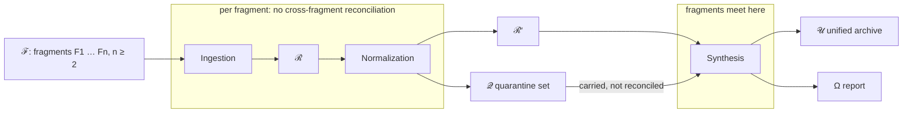

# CHAMP-Pipeline

*A chat history split across devices, rebuilt with every decision on the record.*

A phone goes in for repair, and its owner keeps chatting on a spare handset.
When the phone comes back, one account has two histories: the repaired phone holds
everything up to the failure, the spare holds everything since.
No operation on either device joins them; restoring a backup replaces one with the other.
Nothing was deleted. Both halves survive, and what is missing is the join: a loss by non-union.

[](https://doi.org/10.68485/ijmada.20266168)
[](https://doi.org/10.5281/zenodo.22260521)
[](LICENSE)
[](.nvmrc)
[](https://github.com/stiFFLer-codes/champ-pipeline/actions/workflows/tests.yml)

This repository is the reference implementation of **CARTA** (Chat Archive
Reconstruction and Temporal Access), the reconstruction framework published in the
*International Journal of Management and Data Analytics* (2026).

## The idea in one picture

<p align="center">
  
</p>

*TCF on a timeline (Fig. 1 of the article). C1 and the restore are points; C2 and C3 are spans; hatching marks the overlap regions.*

The article calls this **Temporal Communication Fragmentation (TCF)**: one account's
history split across two or more device-bound instances that persist independently,
with no platform operation that yields their union.

## What CARTA promises

A reconstruction owes its reader five things:

- **Quarantine with typed reasons.** Input that cannot be read unambiguously is kept, with one of six reason codes.
- **Per-record provenance.** Every record traces to its source file, its line range and its bytes.
- **Conflict reporting.** Contradictions and uncertain merges are reported.
- **Stated determinism.** The run is deterministic, and its settings are declared.
- **A structured report.** The report Ω accounts for the run.

The remedy is a contract, not an algorithm. CARTA does not promise the right archive;
it promises that the reader will be told what was done.



*The contract, ℱ → ℛ → (ℛ′, 𝒬) → (𝒰, Ω), as in Equation (1) and Fig. 2 of the article.*

Of 60 chat-merging tools found by a systematic search of GitHub, none fully provides
more than 2 of the five properties (3 when partial implementations count).
CHAMP-Pipeline meets all five together, on synthetic input with known ground truth.

## The result that matters

In scenario (f) of the article's benchmark, one fragment is rendered in +05:30 and
no zone is declared. Over five seeds, every tool, CHAMP-Pipeline included, makes the
same errors. Only one says so.

| Tool | Overlap duplicates left | with a notice | Records misdated | with a notice |
| --- | ---: | ---: | ---: | ---: |
| keepsake | 99 | 0 | 650 | 0 |
| The-Omar-Files | 99 | 0 | 650 | 0 |
| krishnarajt | 99 | 0 | 650 | 0 |
| tarikab7 (HTML) | 99 | 0 | 650 | 0 |
| tarikab7 (Next.js) | 99 | 0 | 650 | 0 |
| **CHAMP-Pipeline** | **99** | **99** | **650** | **650** |

CHAMP-Pipeline was run on each tool's input format, with the same result on every
format. Its notice is one zone-offset advisory per run, naming the two fragments and the
suspected offset; the scoring counts it for every affected record. Source:
[`results/benchmark/scenarios-summary.csv`](results/benchmark/scenarios-summary.csv).

When the data owner is the only person who can check the result, silent resolution
is the failure and visible uncertainty is the safeguard.

## See it in 30 seconds

Node.js 24, no install step, no dependencies. From the repository root:

```sh
node scripts/reconstruct.js --infer --expect data/synthetic_fixtures/tcf-pair/manifest.json \
  data/synthetic_fixtures/tcf-pair/tcf-F1-primary.txt \
  data/synthetic_fixtures/tcf-pair/tcf-F2-secondary.txt
```

```text
CARTA reconstruction (CARTA 1.1; champ-pipeline-core 0.2.0)
  fragments             2
      tcf-F1-primary.txt                     58 normalized,   0 quarantined, inference DMY, zone +00:00 (default)
      tcf-F2-secondary.txt                  134 normalized,   0 quarantined, inference MDY, zone +00:00 (default)
  records into synthesis 192
  |U|                    172
  duplicates collapsed   20
  quarantined            0
  ...
ground-truth check against manifest.json
  ok    |U| messages == ground truth (170)
  ok    duplicates collapsed == overlap (20)
  ok    conservation: |U| + collapsed + quarantined == records ingested
```

The two fragments use different date orders, and `--infer` settles each one from
evidence elsewhere in the same fragment, then says so. Without `--infer`, the same pair
sends 81 records to quarantine instead of guessing. A quarantined record in a report Ω
looks like this (from [`results/e7-representative-omega.json`](results/e7-representative-omega.json)):

```jsonc
{
  "reason": "AMBIGUOUS_DATE_FORMAT",
  "sourceSeq": 8,
  "record": {
    "category": "message",
    "rawTimestamp": "01/02/24, 12:32 am",
    "rawSender": "You"
    // rawBody, rawText and the remaining fields omitted
  },
  "provenance": {
    "source_id": "scenario-F1-primary.txt",
    "line_range": [9, 9],
    "sha256": "06adb88bfc807ea6ef4d5b8e1e955ad6ca4b00cf6b0d28aa0837dfb6bab98bf4",
    "record_sha256": "b0f6ec54c39aea6f6d0e31caac7784a00de31ed049de7a971c390ea3a305e032"
  }
}
```

`01/02/24` is a valid date in both day-month and month-day order, so it is kept with
a reason rather than resolved.

All evaluation is on synthetic data. No real archive has been reconstructed, and
whether real exports behave as the generator assumes is still untested.

## Reproduce the paper

```sh
node tests/run-all.js                  # every check in the repository
node scripts/experiments/run-all.js    # every experiment the article reports
```

`run-all.js` regenerates E1 to E5, E7 and E8 (E3 runs last, on its own) and writes
[`results/paper-numbers.json`](results/paper-numbers.json): every number in the
article is in that file at release v0.2.0. E1 is the longest, at roughly an hour on
a 2-core laptop. The benchmark and the survey have their own scripts (see the
reference sections below).

## Cite

> Sapariya, M. (2026). When Chats Split Apart: Formalizing Temporal Communication
> Fragmentation and the CARTA Reconstruction Framework. *International Journal of
> Management and Data Analytics, 6*(1), 449–470.
> https://doi.org/10.68485/ijmada.20266168

```bibtex
@article{sapariya2026chats,
  author  = {Sapariya, Maitreya},
  title   = {When Chats Split Apart: Formalizing Temporal Communication Fragmentation and the {CARTA} Reconstruction Framework},
  journal = {International Journal of Management and Data Analytics},
  volume  = {6},
  number  = {1},
  pages   = {449--470},
  year    = {2026},
  doi     = {10.68485/ijmada.20266168}
}
```

To cite the code itself:

- This release (v0.2.0): [10.5281/zenodo.23526491](https://doi.org/10.5281/zenodo.23526491)
- All versions (concept DOI): [10.5281/zenodo.22260521](https://doi.org/10.5281/zenodo.22260521)

[`CITATION.cff`](CITATION.cff) carries both, and GitHub's "Cite this repository"
button shows the article.

## Reference

<details>
<summary><b>Options of <code>reconstruct.js</code></b></summary>

```sh
# individual stages
node scripts/ingest.js --json <fragment.txt> ...
node scripts/normalize.js [--zone <IANA name | +HH:MM>] [--infer] <fragment.txt>
```

The stage scripts take `--zone` and `--source-id` the same way.

| Option | Effect |
| --- | --- |
| `--zone <IANA name \| +HH:MM>` | The zone the fragments after it were exported in, until the next `--zone`. Fragments before any `--zone` are read as `+00:00`; Ω records each fragment's zone and whether it was declared or defaulted. |
| `--source-id <id>` | The id of the one fragment after it (it does not carry over). Without it a fragment's id is its file name, and two fragments with the same file name are refused. Ω records which applied (`fragments[].idSource`). |
| `--clustering one-to-one\|complete\|single` | How duplicate observations are grouped. `one-to-one` (default) puts at most one observation per fragment in a record and reports differing per-fragment counts as `dedup_ambiguity`; `complete` is the complete linkage of CARTA 1.0, superseded by `one-to-one` in 1.1; `single` is connected components. |
| `--infer` | Fragment-scope date-order inference before Synthesis. |
| `--dt <ms>` | Deduplication window (default 0, exact match). |
| `--json` | Print the full (U, Ω) as JSON. |
| `--expect <manifest.json>` | Check the run against a `tcf-pair` manifest and exit non-zero on a mismatch. |

</details>

<details>
<summary><b>Regenerating the fixtures</b></summary>

```sh
node scripts/generate-synthetic-fixtures.js                         # the 5 parsing-edge-case fixtures
node scripts/generate-synthetic-fixtures.js --tcf-pair --delta 14 --epsilon 7   # the committed fragment pair
node scripts/generate-synthetic-fixtures.js --scenario <config.json> --out <dir>  # a scenario
```

`--scenario` reads a JSON config (seed, size, 2-4 fragments, δ, ε, timeline
lengths, per-fragment date order, clock and zone, and knobs (a)-(h) for
repeats, sender disagreement, ordering, attachment forms, a synthetic body
variant, a misdeclared zone, clock jitter and zone-dependent date ambiguity) and writes
`scenario-F<i>-primary|secondary.txt` plus a `manifest.json` with the ground
truth and the expected outcome. The parameters and their defaults are
`SCENARIO_DEFAULTS` in `scripts/generate-synthetic-fixtures.js`.

</details>

<details>
<summary><b>Survey and benchmark</b></summary>

Two studies have their own entry points and are not part of `run-all.js`:

```sh
# benchmark: the surveyed tools, unmodified, on the synthetic fragment pair
node scripts/survey/bench/run-benchmark.js

# survey: repository search -> metadata screen -> fetch -> tally
node scripts/survey/search.js
node scripts/survey/screen.js
node scripts/survey/fetch.js <temp-dir>
node scripts/survey/tally.js
```

The benchmark needs `git`, Node, Bun and Python 3.12; it clones each tool at its
pinned commit into a temporary directory outside the repository and writes
`results/benchmark/`. The survey needs network access and uses the
unauthenticated GitHub REST API (10 searches per minute); `fetch.js` clones into
the temporary directory you pass it.

`node scripts/experiments/run-all.js` writes the experiments' deterministic outputs
to `results/` and their timings to `results/timing/`. Name experiments to run a
subset, e.g. `node scripts/experiments/run-all.js e4 e7` (paper-numbers still runs
last). `node tests/run-all.js` runs the four `test-*.js` files plus the corpus
checker, five checks in total.

</details>

<details>
<summary><b>Repository layout</b></summary>

| Path | Contents |
| --- | --- |
| `core/src/` | The pipeline: `ingestion/`, `normalization/`, `inference/`, `synthesis/` (Node standard library only, zero dependencies) |
| `core/` | `champ-pipeline-core` package manifest |
| `scripts/` | CLI entry points (`ingest.js`, `normalize.js`, `reconstruct.js`), the fixture generator and the corpus checker |
| `scripts/experiments/` | Experiment drivers E1 to E5, E7 and E8, `run-all.js` and `paper-numbers.js` |
| `scripts/survey/` | Survey pipeline and the `bench/` benchmark drivers |
| `tests/` | Self-checking test files; `run-all.js` runs every check |
| `data/synthetic_fixtures/` | Generated WhatsApp-export fixtures, including the `tcf-pair/` fragment pair with a ground-truth manifest |
| `docs/` | The CARTA specification, the source-evidence note for claims about other software, and `figures/` |
| `paper/` | A pointer to the published article (the pre-review LaTeX draft is superseded) |
| `results/` | Committed experiment outputs, benchmark and survey data, and `paper-numbers.json` |

</details>

## Data and ethics

Every fixture is produced by `scripts/generate-synthetic-fixtures.js` from a seed.
The repository contains **no real personal chat data** anywhere: no messages,
contacts, phone numbers, media or archives, in code, tests, examples, results or
history. No data were collected from people, so no ethics approval applies.

## Licence and author

MIT. See [`LICENSE`](LICENSE).

**Maitreya Sapariya**, Department of Information Technology, A. D. Patel Institute of
Technology (ADIT), CVM University, Gujarat, India.
[ORCID 0009-0003-9346-3775](https://orcid.org/0009-0003-9346-3775)
